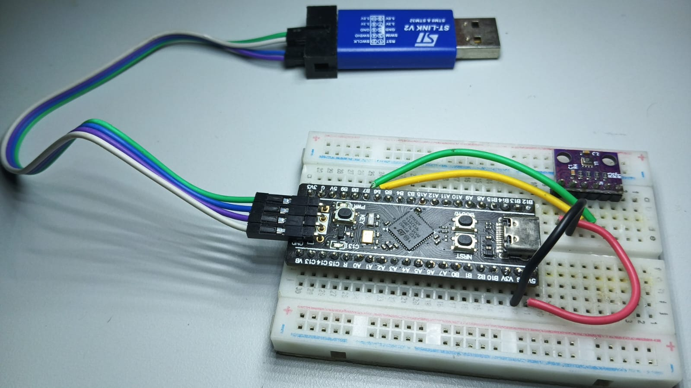

# BMP280-Scratch-I2C-Driver

### A demo usage of this project is shown in [this youtube video](https://youtu.be/9rb_QE7yvto?si=5Z7McSPA7PZpIOzA)

<h3>This project is an implementation of an I2C driver from scratch using CMSIS headers.</h3>

<h3> Original code is MIT-licensed; ST and ARM files retain their own licenses. </h3>

<h2>Requirements :</h2>

* This repo is made to store my progress of implementing a bare metal i2c driver on the stm32 for a bmp280 sensor.
* Commit message convention is `DD/MM/YY_HH:MM - REMARKS`
* CHANGELOG.md contains mistakes, their solutions and learning.

### Hardware I am using:
* **Microcontroller :** STM32F411CEU6 (Black Pill).
* **Sensor :** BMP280 Sensor.
* **Debugger and Programmer :** ST-LINK V2 (or onboard ST-LINK)
* **Connecting wires and breadboard.**
* Logic Analyzer

### Software:
* **[STM32CubeIDE](https://www.st.com/en/development-tools/stm32cubeide.html)** (v1.10.0 or higher recommended)

### Pinout
| BMP280 Pin | STM32 Pin | Description |
| :--- | :--- | :--- |
| **VCC** | 3.3V | Power Supply (3.3V) |
| **GND** | GND | Ground |
| **SCL / SCK** | PB6 (I2C1_SCL) | I2C Clock / SPI Clock |
| **SDA / SDI** | PB7 (I2C1_SDA) | I2C Data / SPI MOSI |

### Setup that I used:



## Getting started:

Follow these steps to clone, open, build, and run this project on your local setup.

### Step 1: Clone the Repository
Open your terminal or command prompt and clone the repository:

```bash
git clone https://github.com/ManaswiMukherjee/BMP280-Scratch-I2C-Driver
cd BMP280-Scratch-I2C-Driver
```

---

### Step 2: Import into STM32CubeIDE
1. Launch **STM32CubeIDE**.
2. Select your workspace directory and click **Launch**.
3. In the top menu, go to **File** -> **Import...**
4. Select **General** -> **Existing Projects into Workspace**, then click **Next**.
5. Choose **Select root directory**, click **Browse...**, and select the cloned `BMP280` project folder.
6. Make sure the project `BMP280` is checked in the list.
7. **Important:** Do **NOT** check *"Copy projects into workspace"* (keeping it unchecked ensures Git continues tracking your changes in place).
8. Click **Finish**.

---

### Step 3: Build the Project
1. In the **Project Explorer** window on the left, right-click on the `BMP280` project.
2. Select **Build Project** (or press `Ctrl + B`).
3. Ensure the build completes with **0 Errors**.

---

### Step 4: Flash and Debug
1. Connect your ST-LINK programmer to your PC and the STM32 board.
2. Click on the drop-down arrow next to the **Debug** button (bug icon) in the top toolbar.
3. Select **BMP280 Debug** (this uses the pre-configured `BMP280 Debug.launch` file).
4. Click **Resume** (green play button `F8`) to run the code.

---

## Limitations (v0.1)

- **Polling only.** No interrupt or DMA transfers; the CPU busy-waits on status flags.
- **I2C1 only** (PB6/PB7), fixed at 100 kHz standard mode with a 16 MHz APB1 clock. Other clock setups need new CR2/CCR/TRISE values.
- **Timeouts are iteration counts, not time.** Real duration depends on the compiler optimization level.
- **No 2-byte read.** `i2c_read` supports 1 byte and 3 or more bytes; 2 returns `I2C_ERR_ARG` (not needed for the BMP280).
- **No bus recovery.** A slave holding SDA low is not cleared by toggling SCL.
- **Single master, single sensor instance tested.**
- **Error reporting is minimal.** `getTemperature()` and `getPressure()` return `-1` on failure, which cannot occur as a valid reading in the intended environment, and each performs its own sensor read, so the two values may come from different samples.
- **Blocking, not thread-safe.** No RTOS or concurrency support.
- **Hardware assumptions.** External pull-ups come from the breakout board (none are enabled on the MCU pins); the sensor is expected at 0x76 or 0x77 and reports chip ID 0x58 (a BME280 will be rejected).

---
# Project Structure
## Project structure

```text
BMP280/
├── Core/
│   ├── Inc/
│   │   ├── i2c.h          # I2C driver API and status codes
│   │   └── bmp280.h       # BMP280 registers, types, API
│   └── Src/
│       ├── i2c.c          # Bare-metal I2C1 driver (register level)
│       ├── bmp280.c       # Sensor init, raw read, compensation
│       └── main.c         # Example usage
├── sensor_arduino/        # Reference sketch using the Adafruit library,
│                          # used to cross-check readings (RP2040)
├── logic_analyzer_test/   # Pico sketch that generates known UART/SPI/PWM
│                          # signals to validate the logic analyzer setup
├── tests/test.txt         # Bring-up snippets used during development
├── Docs/                  # Setup photo and logic analyzer capture
├── CHANGELOG.md           # Bugs, fixes and learning log
└── BMP280.ioc             # CubeMX project file (clock/pin scaffolding)

```

The remaining files under `Core/` (startup, system, syscalls, linker scripts) are STM32CubeIDE-generated scaffolding.